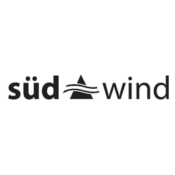

# ioBroker.ambientika

[](https://www.npmjs.com/package/iobroker.ambientika)
[](https://www.npmjs.com/package/iobroker.ambientika)


**Tests:** 

## Ambientika adapter for ioBroker

Official ioBroker adapter for **Ambientika** decentralised ventilation units with heat recovery.
Developed and maintained by **Südwind GmbH** (SUEDWIND S.R.L.), Eppan/Appiano, South Tyrol, the manufacturer of Ambientika.

Sign in with the e-mail address and the password of your Ambientika app. The adapter finds all units of the
account, shows their values and lets you control them from ioBroker. Nothing else has to be installed.

## Supported devices

All Ambientika units that are set up in the **Ambientika app** (for example SMART and OFFICE). The adapter uses the
same Ambientika cloud account as the app, so the units need their Wi-Fi connection and the ioBroker host needs
internet access.

## Installation

In ioBroker Admin open **Adapters**, search for **Ambientika** and install it. Then open the settings of the new
instance `ambientika.0`.

## Configuration

| Setting | Default | Description |
| --- | --- | --- |
| Connection type | Ambientika cloud | See [Connection types](#connection-types) |
| E-mail address, Password | *(empty)* | The same as in the Ambientika app. The password is stored encrypted. |
| Reading interval | `30` | Seconds between two readings of all units (10 to 3600) |

After saving, the units appear below `ambientika.0` within a few seconds, named as in the app.
`ambientika.0.info.connection` shows whether the adapter reaches the Ambientika cloud.

## States

Every unit appears as the device `ambientika.0.<serial number>` with the name it has in the Ambientika app. The ids
are tied to the serial number: a unit can be renamed in the app without a state changing its id.

### Read and write

| State | Values | Description |
| --- | --- | --- |
| `operating_mode` | Smart, Auto, ManualHeatRecovery, Night, AwayHome, Surveillance, TimedExpulsion, Expulsion, Intake, MasterSlaveFlow, SlaveMasterFlow, Off | Operating mode. For coupled units set the mode at the Master of the zone; a Slave runs with its Master. |
| `fan_speed` | Low, Medium, High (Night, Turbo) | Fan speed. Night and Turbo are steps the unit chooses itself (for example in Smart mode). They are shown; when one of them is written (a scene that restores what it saw), the adapter sets the nearest step instead: Low for Night, High for Turbo. |
| `humidity_level` | Dry, Normal, Moist | Humidity setting |
| `light_sensor_level` | Off, Low, Medium (NotAvailable) | Sensitivity of the twilight sensor |
| `reset_filter` | button | Resets the filter counter after a filter change (write `true`). The cloud clears the counter of a Master; a coupled Slave keeps its own until it is reset at the unit. |

Write a value without `ack`, as scripts and visualisations do. The adapter sends it to the unit and confirms the
state with `ack: true`. A value that is not in the list is not sent; the log of the instance says which values are
allowed.

### Read only

| State | Description |
| --- | --- |
| `temperature`, `humidity` | Current reading of the unit |
| `air_quality` | Air quality: VeryGood, Good, Medium, Poor, Bad |
| `filters_status` | Filter status: Good, Medium, Bad |
| `humidity_alarm` | Humidity alarm of the unit |
| `night_alarm` | Night signal of the unit (twilight sensor) |
| `last_operating_mode` | The mode before the current one |
| `device_role`, `zone_index` | Master or Slave role and zone |
| `online` | The cloud has a current status of the unit. After three readings without one it turns `false`; the other states keep their last values. |
| `*_num` | Numeric companion values for charts: `operating_mode_num` 0 to 11 in the order above, `fan_speed_num` 1 Low to 5 Turbo, `humidity_level_num` 0 to 2, `light_sensor_level_num` 0 to 3, `air_quality_num` 4 very good to 0 bad, `filter_status_num` 0 good to 2 bad |

## Example: ventilate the bathroom after a shower

```javascript
on({ id: 'ambientika.0.A0B1C2D3E401.humidity', change: 'ne' }, obj => {
    if (obj.state.val > 75) {
        setState('ambientika.0.A0B1C2D3E401.fan_speed', 'High');
    }
});
```

## Connection types

**Ambientika cloud** (default): the adapter signs in to the Ambientika cloud itself, as described above.

**Ambientika MQTT Bridge**: the adapter reads the topics of the
[Ambientika MQTT Bridge](https://github.com/ambientika-eu/ambientika-mqtt-bridge) from your MQTT broker, as the
adapter versions 1.x did. Choose it when you run the bridge anyway, for example for NeuraCell-X® radon and
dew-point protection. In addition to the states above it shows averaged readings, the diagnostics of the bridge
per unit, `info.bridge` and the NeuraCell-X® status below `ambientika.0.neuracell`. The settings are the MQTT broker
(host, port, user, password, TLS), the topic prefix of the bridge and its discovery prefix.

The state ids are the same for both connection types.

### Updating from 1.x

An instance that was set up with version 1.x
keeps reading the MQTT Bridge; nothing has to be changed. To read the units directly, choose the connection type
**Ambientika cloud** in the settings of the instance and enter the sign-in data of the app. Units, their ids and your
scripts stay as they are; the bridge is not needed for the adapter any more. The states that only the bridge fills
(averaged readings, `diagnostics`, `neuracell`, `info.bridge`) are removed at that change.

## Troubleshooting

- **"did not accept e-mail address and password"** in the log: the data differ from those of the Ambientika app.
  Correct them in the settings. The adapter does not keep trying with a wrong password; it tries again after
  30 minutes or when the settings are saved.
- **`info.connection` is false:** the Ambientika cloud cannot be reached. The log names the reason once. The adapter
  tries again on its own, first after 15 seconds, then at longer intervals up to five minutes.
- **A unit shows `online` false:** the cloud has no current status of this unit. Check in the Ambientika app whether
  the unit is reachable there (Wi-Fi, power).
- **A unit is missing:** it has to be set up in the Ambientika app under the same account. New units appear within
  ten minutes, or at once after a restart of the instance.
- **A Slave does not change its mode:** coupled units are set at the Master of their zone.

Support: info@ambientika.eu, or an [issue](https://github.com/ambientika-eu/ioBroker.ambientika/issues).

## Changelog
<!--
    Placeholder for the next version (at the beginning of the line):
    ### **WORK IN PROGRESS**
-->
### 2.0.0 (2026-11-21)
- (Südwind GmbH) The adapter reads the units directly from the Ambientika cloud: sign in with the e-mail address and password of the Ambientika app, nothing else to install.
- (Südwind GmbH) The Ambientika MQTT Bridge remains available as a second connection type. Existing installations keep running unchanged.
- (Südwind GmbH) The adapter has its own repository and package: `ambientika-eu/ioBroker.ambientika`, `iobroker.ambientika` on npm.
- (Südwind GmbH) Settings page in eleven languages. Requires Node.js 22, js-controller 6.0.11 and Admin 7.6.20 or newer.

### 1.6.35 (2026-11-17)
- (Südwind GmbH) Last version that needed the Ambientika MQTT Bridge, published in the repository of the bridge.

## License

MIT License

Copyright (c) 2026 Südwind GmbH (SUEDWIND S.R.L.) <info@ambientika.eu>

Permission is hereby granted, free of charge, to any person obtaining a copy
of this software and associated documentation files (the "Software"), to deal
in the Software without restriction, including without limitation the rights
to use, copy, modify, merge, publish, distribute, sublicense, and/or sell
copies of the Software, and to permit persons to whom the Software is
furnished to do so, subject to the following conditions:

The above copyright notice and this permission notice shall be included in all
copies or substantial portions of the Software.

THE SOFTWARE IS PROVIDED "AS IS", WITHOUT WARRANTY OF ANY KIND, EXPRESS OR
IMPLIED, INCLUDING BUT NOT LIMITED TO THE WARRANTIES OF MERCHANTABILITY,
FITNESS FOR A PARTICULAR PURPOSE AND NONINFRINGEMENT. IN NO EVENT SHALL THE
AUTHORS OR COPYRIGHT HOLDERS BE LIABLE FOR ANY CLAIM, DAMAGES OR OTHER
LIABILITY, WHETHER IN AN ACTION OF CONTRACT, TORT OR OTHERWISE, ARISING FROM,
OUT OF OR IN CONNECTION WITH THE SOFTWARE OR THE USE OR OTHER DEALINGS IN THE
SOFTWARE.

*NeuraCell-X® and PhaseCell-X® are registered trademarks of Südwind / Ambientika.*
